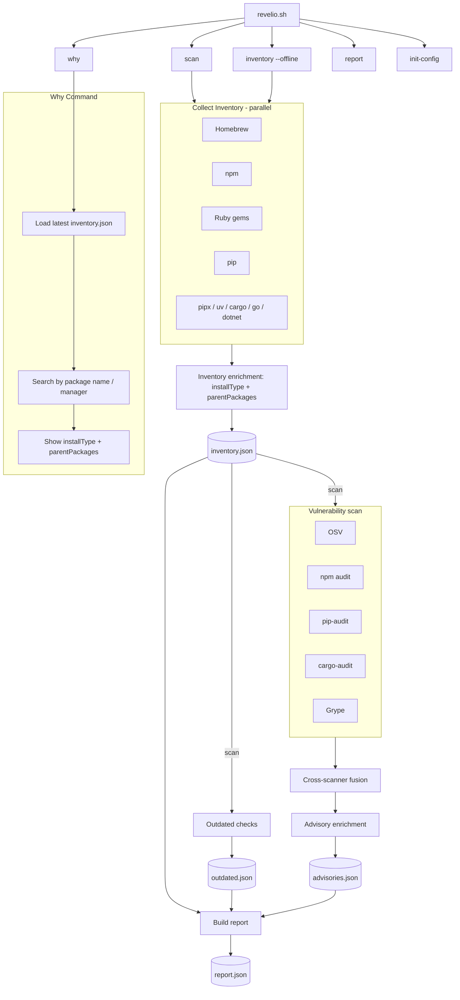

# revelio

**Host-level dependency audit CLI for macOS.**

Revelio inventories the tools installed on your machine, checks what is outdated, correlates findings across multiple vulnerability sources, and tells you which top-level package is responsible. It is designed for the stuff project-scoped scanners miss: global CLIs, language toolchains, package-manager installs, and transitive dependencies already living on your laptop.

## Why use it

- **Host-scoped, not project-scoped**: scans what is actually installed across Homebrew, npm globals, pip, pipx, uv, cargo, gems, Go tools, and dotnet tools.
- **One report, not five**: combines OSV, npm audit, pip-audit, cargo-audit, and Grype, then deduplicates overlapping findings.
- **Actionable remediation context**: attributes vulnerable transitive packages back to the parent or root package you can actually upgrade, with status, rationale, and suggested commands.
- **Useful even offline**: inventory mode works without network lookups.
- **No service required**: standalone Bash CLI with no cloud account or daemon.

## How it compares

Most security scanners are **project-scoped**. Revelio is **host-scoped**: it audits packages already installed on the machine, across package managers, in one run.

| Feature | revelio | Trivy | Grype | Snyk | OSV-scanner |
| --- | --- | --- | --- | --- | --- |
| Host-level package-manager inventory | Yes | Partial | Partial | No | No |
| Multi-ecosystem host scan in one run | Yes | No | No | Partial | No |
| Cross-scanner deduplication | Yes | No | No | No | No |
| Parent package attribution | Yes | No | No | Partial | No |
| Remediation status guidance | Yes | No | No | Partial | No |
| No account required | Yes | Yes | Yes | No | Yes |
| Bash-native workflow | Yes | No | No | No | No |

Trivy and Grype are strong filesystem and container scanners, but they do not enumerate native package-manager data such as `brew list`, `gem list`, `pip list`, or `go env`, so host-package coverage is only partial. Snyk supports multiple ecosystems, but it expects project context and an account rather than a purely local host audit workflow.

## What ships today

| Capability | Status | Notes |
| --- | --- | --- |
| Host inventory across major package managers | Yes | Produces inventory artifacts under `~/.revelio/<run-id>/` by default |
| Outdated package checks | Yes | Per-manager outdated summaries are included in the run output |
| Vulnerability aggregation + deduplication | Yes | OSV, npm audit, pip-audit, cargo-audit, Grype |
| Parent / root package attribution | Yes | Helps explain which direct install owns a vulnerable transitive dep |
| `why <package>` reverse dependency tracing | Yes | Supports multiple package managers |
| Report rendering from existing artifacts | Yes | `report` summarizes the latest or a specific run |
| Scheduled runs | Not yet | Planned |
| Bulk upgrade workflows | Not yet | Planned |
| Roll back to an older safer version | Not yet | Planned |
| Compare two reports over time | Not yet | Planned |

## Quick start

### Requirements

- macOS
- Bash 4 or newer (`brew install bash`; macOS's bundled Bash 3.2 is not supported)
- `jq`
- `curl`

Optional scanners and manager CLIs improve coverage when present, including `brew`, `npm`, `pip`, `pipx`, `uv`, `cargo`, `go`, `dotnet`, `pip-audit`, `cargo-audit`, and `grype`.

Revelio fails fast on unsupported Bash versions and prints a Homebrew install hint instead of breaking later on Bash 4-only features.

### Installation

```bash
git clone https://github.com/a-magdy/revelio.git
cd revelio
```

No build step required. The CLI runs directly from the repository.

### Run it

```bash
# If `bash` still resolves to macOS's old /bin/bash, invoke the Homebrew one directly
# "$(brew --prefix)/bin/bash" ./revelio.sh scan

# Full host dependency scan
./revelio.sh scan

# Inventory only, with no network lookups
./revelio.sh inventory --offline

# Read the latest report, or a specific run
./revelio.sh report
./revelio.sh report ~/.revelio/<run-id>

# Explain why something is installed
./revelio.sh why openssl@3
./revelio.sh why nokogiri --manager gem

# Create a starter config in the current directory
./revelio.sh init-config
```

## Core commands

| Command | Purpose |
| --- | --- |
| `scan` | Inventory + outdated checks + vulnerability checks |
| `inventory` | Inventory only; skips vulnerability lookups |
| `report [path]` | Render a terminal summary for the latest or specified run. Respects `--output-dir` and `--config` for locating runs |
| `why <package>` | Show why a package is installed and who depends on it. Use `--manager <mgr>` to limit search; without it, all managers are searched |
| `init-config [path]` | Write a starter config file |

### Common options

- `--config <path>`
- `--output-dir <path>`
- `--severity <none|low|medium|high|critical>`
- `--offline` / `--online`
- `--deep-scan` / `--no-deep-scan`
- `--no-fail` / `--fail`
- `--fail-on-scanner-errors` / `--no-fail-on-scanner-errors`

## What a run produces

Each run writes a timestamped directory under `~/.revelio/<run-id>/` unless you override `defaults.outputDir`.

Key artifacts:

- `report.json` — top-level summary and policy result
- `inventory/packages.json` — normalized package inventory
- `outdated/items.json` — outdated package records
- `scans/findings.json` — raw vulnerability findings
- `scans/advisories.json` — deduplicated, enriched remediation view

Each advisory in `advisories.json` carries:

- `evidenceSources` — which scanners found this (e.g., `["osv","npm-audit"]`)
- `remediationStatus` — whether a fix is available now, pending release, or not yet released
- `remediationMessage` — human-readable guidance
- `recommendedVersion` and `upgradeRationale` — why the suggested target was chosen
- `upgradeCommand` — what to run
- `primaryParent` and `responsibleParents` — which direct installs own the vulnerable transitive dep
- npm release-channel fields when applicable: `rootPackage`, `rootInstalledVersion`, `rootLatestVersion`, `rootIsLatest`
- npm pending-release fields: `pendingReleaseTag`, `pendingReleaseVersion`, `pendingResolvedVersion`

The CLI report summary also prints parent-package attribution, remediation status, suggested upgrade commands, and a dedicated hang-tight section when pending-release evidence is present.

## Inventory enrichment

The package inventory includes two important fields per package:

- `installType` — `direct`, `dependency`, `default`, or `unknown`
- `parentPackages` — JSON array of parent package names, sorted and deduplicated

Manager-specific resolution:

- **Homebrew** — `brew leaves` for direct formulae, `brew deps --installed` for the dependency graph
- **npm** — depth-based (`1` = direct, `>1` = dependency), parent inferred from the dependency path
- **Ruby gems** — `gem dependency --reverse-dependencies` for dependency chains, plus the `default:` marker
- **pip** — `pip show` parsing with the `Required-by` field
- **pipx / uv / cargo / go / dotnet** — always treated as direct installs

## Design details

### Parent attribution

For each vulnerable transitive dependency, Revelio resolves the immediate parent (`primaryParent`), all depending packages (`responsibleParents`), and the top-level direct install (`rootPackage`). This tells you which `brew upgrade` or `npm install -g` to run rather than which CVE to look up.

### Remediation status and npm release-channel enrichment

Each advisory carries a `remediationStatus`:

- `actionable-update-now` — a stable fix exists
- `upstream-pending-release` — fix is available on a prerelease channel
- `no-fix-released` — no upstream fix yet

For npm globals, when the root package is already on the latest stable release and the transitive vulnerability has no stable-channel fix, Revelio scans active prerelease dist-tags (`beta`, `rc`, `next`, etc.) and checks whether the candidate resolves the vulnerable dependency to a patched version. If so, the advisory is classified as `upstream-pending-release` with the specific release tag and version, so you know whether to wait rather than seeing an open advisory on every run.

### Cross-scanner fusion

Five scanners can report the same CVE. Revelio deduplicates by canonical identity `(manager, ecosystem, package, id, dependencyPath)` and merges `evidenceSources` arrays — one advisory per finding, not five.

### NDJSON streaming pipeline

Collectors and scanners append NDJSON as they run, then a final `jq -s` consolidation pass turns those streams into JSON artifacts. That keeps large scans composable, reduces memory pressure, and avoids corrupting shared JSON arrays during concurrent collection.

### Runtime isolation

Package-manager caches and scanner state are redirected into the run directory so scans do not affect your normal tool state. Homebrew, npm, pip, uv, gems, and Grype all use per-run state instead of leaking cache or analytics side effects into the user environment.

### Subshell execution model

The scan runs inside a subshell so failures abort cleanly, partial artifacts remain available for debugging, and the CLI can return a clean non-zero exit without leaking intermediate state.

## Configuration

`revelio.config.json` controls run behavior. Important defaults:

| Key | Default | Purpose |
| --- | --- | --- |
| `defaults.outputDir` | `~/.revelio` | Root directory for run artifacts |
| `defaults.severityThreshold` | `high` | Minimum severity that triggers failure policy |
| `defaults.failOnFindings` | `true` | Exit non-zero when findings meet the threshold |
| `defaults.failOnScannerErrors` | `true` | Exit non-zero when enabled collectors or scanners fail |
| `defaults.deepScan` | `false` | Adds deep Grype filesystem targets |
| `defaults.allowNetworkQueries` | `true` | Enables OSV and related network lookups |
| `scanners.npmReleaseChannelChecks` | `true` | Enables npm prerelease-channel remediation enrichment |

## How it works



## Roadmap

These are **planned ideas**, not current CLI features.

### Scheduled runs on macOS

- Install a LaunchAgent so Revelio can run at login and on a daily schedule
- Make cadence configurable
- Allow enabling or disabling scheduled scans from config and, later, a dedicated CLI command
- Write reports to the normal output directory so scheduled and manual runs share the same artifact model

### Bulk upgrade assistance

- Generate manager-aware upgrade suggestions for multiple actionable advisories in one pass
- Prefer dry-run or confirmation-first workflows over silent changes
- Keep remediation tied to the advisory output so users know why each upgrade is recommended

### Roll back to an older safer version

- Explore safer-version guidance for ecosystems that support explicit version installs
- Treat this as a constrained workflow, not a blanket "downgrade everything" action
- Preserve auditability so users can see what changed and why

### Compare reports over time

- Add a command to compare two `report.json` files or run directories
- Highlight new findings, resolved findings, package version drift, and policy changes
- Use the existing per-run artifact layout as the comparison input

## Development

### Smoke checks

```bash
./ci-smoke.sh
```

That script runs `shellcheck`, exercises `help`, `inventory --offline`, `report`, a best-effort `why jq --manager brew` check, and `init-config`, then validates that `report.json` exists with the expected shape.

## Contributing

Revelio is in early development. Bug reports and feature requests are welcome via [GitHub Issues](https://github.com/a-magdy/revelio/issues). If you would like to contribute code, please open an issue first to discuss the change.

## Security

If you discover a vulnerability in Revelio itself, please report it privately via [GitHub Security Advisories](https://github.com/a-magdy/revelio/security/advisories/new) rather than opening a public issue.

## License

This project does not yet have a license. Until one is added, standard copyright applies. If you would like to use Revelio in your own work, please open an issue to discuss licensing.
