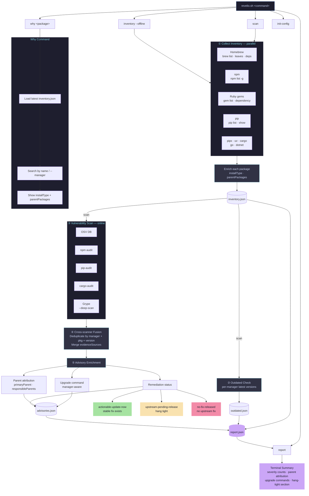

# revelio

Standalone host dependency audit CLI.

## Design highlights

### npm release-channel enrichment

The most distinctive feature — not found in other security tools.

When a transitive npm vulnerability cannot be fixed by a direct upgrade (because your root package is already on the latest stable release), revelio does not just report it as a dead-end `no-fix-released`. Instead, it:

1. Identifies which root package owns the vulnerable transitive dependency
2. Confirms the root is on the latest stable release via `npm view dist-tags`
3. Scans all active pre-release channels (`beta`, `rc`, `alpha`, `next`, `canary`) for newer root versions
4. For each candidate pre-release, traverses the full dependency path through the npm registry to check whether the vulnerable transitive dep would be resolved to a fixed version
5. If found, classifies the advisory as `upstream-pending-release` with the specific release tag, version, and resolved-dep version

This eliminates alert fatigue on "known transitive vulnerability waiting on upstream" — you see exactly which release channel will fix it, rather than a generic open advisory on every run.

The relevant config key is `scanners.npmReleaseChannelChecks` (default: `true`). The output fields are `remediationStatus`, `pendingReleaseTag`, `pendingReleaseVersion`, and `pendingResolvedVersion` in `advisories.json`.

### Cross-scanner deduplication

Five scanners (OSV, npm audit, pip-audit, cargo-audit, Grype) can all find the same CVE. revelio deduplicates findings by canonical identity `(manager, ecosystem, package, id, dependencyPath)` and merges `sourceScanners` arrays — one advisory per package, not five duplicate alerts per run.

### NDJSON streaming pipeline

Inventory collectors and scanners append NDJSON to shared `.ndjson` files as they run, rather than building in-memory arrays. A final `jq -s` pass consolidates each file into JSON. This keeps individual operations composable, lets any collector fail without corrupting others, and avoids memory pressure on large package sets.

### Runtime environment isolation

Before any package-manager commands run, all tool-specific caches are redirected into a per-run `runtime-cache/` directory inside the run output folder (`NPM_CONFIG_CACHE`, `PIP_CACHE_DIR`, `UV_CACHE_DIR`, `GEM_SPEC_CACHE`, `GRYPE_DB_CACHE_DIR`, etc.). Update notifications and analytics are suppressed for all managers. No side effects to your global tool state.

### Subshell execution model

The entire scan execution runs inside a subshell (`if ! ( ... ); then`). Failures abort cleanly, partial artifacts are preserved at the run directory for debugging, and the function returns a clean non-zero exit without leaking intermediate state.

### Parent attribution at every layer

For each vulnerable finding, revelio resolves `primaryParent` (the immediate requiring package), `responsibleParents` (all packages that depend on the vulnerable dep), and `rootPackage` (the top-level direct install that owns the transitive chain). This tells you exactly which `brew upgrade` or `npm install -g` to run — not just which CVE to look up.

### `why <package>` — reverse dependency tracing

`revelio.sh why <pkg>` resolves the install reason for any package across all supported managers. For Homebrew it uses `brew uses --installed` and `brew deps --direct`; for gems, `gem dependency --reverse-dependencies`; for npm, the global dependency tree; for pip, `pip show`'s `Required-by` field. No graph database — pure native package manager queries.

### Smoke-tested

`ci-smoke.sh` runs `help`, `inventory --offline`, `report`, a best-effort `why jq --manager brew` check (skipped when `jq` is not installed via Homebrew), and `init-config`, then validates that `report.json` was produced, has the correct `mode`, and that advisory objects carry all required remediation and evidence fields. Run it before committing changes.

## Quick usage

```bash
# Full host dependency scan
./revelio.sh scan

# Inventory only (no vulnerability lookups)
./revelio.sh inventory --offline

# Show summary for the latest run
./revelio.sh report

# Show summary for a specific run
./revelio.sh report ~/.revelio/<run-id>

# Find out why a package is installed
./revelio.sh why openssl@3
./revelio.sh why nokogiri --manager gem

# Create a starter config
./revelio.sh init-config
```

## Common options (scan/inventory)

- `--config <path>`
- `--output-dir <path>`
- `--severity <none|low|medium|high|critical>`
- `--offline` / `--online`
- `--deep-scan` / `--no-deep-scan`
- `--no-fail` / `--fail`
- `--fail-on-scanner-errors` / `--no-fail-on-scanner-errors`

Artifacts default to: `~/.revelio`.

## Report command

`report` defaults to the latest report when no path is given. Use `--output-dir` or `--config` to override where it looks.

## Why command

`why <package>` shows why a package is installed — whether it is a direct install or a
transitive dependency, plus the list of parent packages that depend on it.

Options:
- `--manager <mgr>` — limit search to a specific package manager (e.g., `brew`, `gem`, `pip`, `npm`)

When no manager is specified, all supported managers are searched.

## Inventory enrichment

The package inventory now includes two additional fields per package:

- `installType` — `direct`, `dependency`, `default`, or `unknown`
- `parentPackages` — JSON array of parent package names (sorted, unique)

Manager-specific resolution:
- **Homebrew**: `brew leaves` for direct formulae, `brew deps --installed` for dependency graph
- **npm**: depth-based (1=direct, >1=dependency), parent from dependency path
- **Ruby gems**: `gem dependency --reverse-dependencies` for dependency chains, `default:` marker
- **pip**: `pip show` batch with `Required-by` field parsing
- **pipx / uv / cargo / go / dotnet**: always `direct` (top-level by nature)

## Advisory output details

`scans/advisories.json` includes enriched remediation metadata per vulnerable package:

- `evidenceSources` (merged scanner provenance, e.g. `["osv","npm-audit"]`)
- `recommendedVersion` and `upgradeRationale`
- `upgradeCommand` (manager-aware suggested command)
- `primaryParent` and `responsibleParents` (best-effort parent dependency attribution)
- `remediationStatus` and `remediationMessage`:
  - `actionable-update-now`
  - `upstream-pending-release` (hang-tight guidance)
  - `no-fix-released`
- npm release-channel context fields:
  - `rootPackage`, `rootInstalledVersion`, `rootLatestVersion`, `rootIsLatest`
  - `pendingReleaseTag`, `pendingReleaseVersion`, `pendingResolvedVersion`

The CLI report summary (`revelio.sh scan` and `... report`) also prints parent-package attribution, remediation status, suggested upgrade commands, and a dedicated **hang tight** section when pending-release evidence is detected.

### Relevant config keys

- `scanners.npmReleaseChannelChecks` (default: `true`) — enable npm dist-tag release-channel enrichment used for pending-release detection.

## How it works



## How revelio compares to other tools

Most security tools are **project-scoped** — they scan a `package.json`, `Gemfile`, or `requirements.txt`. revelio is **host-scoped**: it audits the packages actually installed on your machine across every package manager in one run.

| Feature | revelio | Trivy | Grype | Snyk | OSV-scanner |
|---|---|---|---|---|---|
| Host-level (not project-based) | ✅ | ⚠️ filesystem/image scan, not pkg-mgr APIs | ⚠️ filesystem/image scan, not pkg-mgr APIs | ❌ requires project context | ❌ |
| Multi-ecosystem in one run (brew/npm/pip/pipx/uv/cargo/gems/go/dotnet) | ✅ | ❌ no brew/gems/go native support | ❌ no brew/gems/go native support | ⚠️ per-project, account required | ❌ |
| Cross-scanner fusion with deduplication | ✅ OSV + npm audit + pip-audit + cargo-audit + grype | ❌ | ❌ | ❌ | ❌ |
| Transitive dependency attribution (`primaryParent`, `responsibleParents`) | ✅ | ❌ | ❌ | ⚠️ paid tier | ❌ |
| Remediation status (`actionable-update-now` / `upstream-pending-release` / `no-fix-released`) | ✅ | ❌ | ❌ | ⚠️ paid tier | ❌ |
| `why <pkg>` dependency graph tracing | ✅ | ❌ | ❌ | ❌ | ❌ |
| No account or cloud required | ✅ | ✅ | ✅ | ❌ | ✅ |
| Zero runtime to install (pure Bash) | ✅ | ❌ | ❌ | ❌ | ❌ |

> ⚠️ = partial/conditional support. Trivy and Grype excel at container and filesystem scanning but query files on disk rather than native package manager databases — they don't enumerate `brew list`, `gem list`, `pip list`, or `go env` output. Snyk supports multiple ecosystems but requires a project manifest and an account; it does not scan your global host environment.

### Key differentiators

- **Host-level scanning** — audits your actual machine environment, not a project lockfile. Catches vulnerabilities in globally installed tools (CLI utilities, language runtimes, build tools) that project-level scanners miss entirely.
- **Multi-scanner fusion** — runs OSV, npm audit, pip-audit, cargo-audit, and Grype in a single pass and deduplicates findings by canonical identity across all sources, so you see one advisory per package — not five duplicate alerts.
- **Parent attribution** — for each vulnerable transitive dependency, revelio identifies which top-level package is responsible, so you know which direct install to upgrade rather than hunting through the dependency graph yourself.
- **Actionable remediation** — each finding carries a `remediationStatus` (`actionable-update-now`, `upstream-pending-release`, `no-fix-released`), a suggested upgrade command, and npm release-channel context so you know whether to act now or wait.
- **Bash-native, zero setup** — a single shell script with no language runtime, no daemon, no cloud account needed. Works offline for inventory-only runs.
